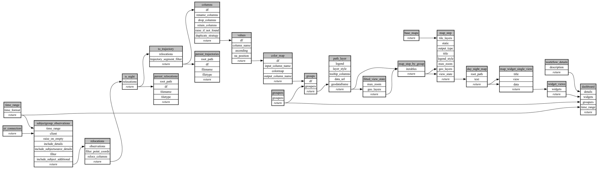

```
# AUTOGENERATED BY ECOSCOPE-WORKFLOWS; see fingerprint in README.md for details

```

```yaml
# fingerprint:
artifacts_sha256_basic: cd3ceba1eae8831593b26ca448416fedad2269eb7c893ad9cb66155a3e2792df
artifacts_sha256_strict: f9bd06b6107a96189452a7bd0aeb1fc32d680dad708346fef3ddad673a4dff50
installed_requirements:
- channel: https://repo.prefix.dev/ecoscope-workflows/
  name: ecoscope-platform
  version: {version: ==2.25.3}
- channel: https://repo.prefix.dev/ecoscope-workflows-custom/
  name: ecoscope-workflows-ext-custom
  version: {version: ==0.1.3}
- channel: conda-forge
  name: pydeck
  version: {version: ==0.9.2}
params_sha256: aa2a09aeaa50b27bd2b460631ea91b27279465d2d98ff03630823f8827332f94
spec_sha256: f8e7d9ac6c33d1470c6ba52368a643913ea8112ae7f719ed193c90458a666d4b

```

# ecoscope-workflows-subject-day-night-location-map-workflow


