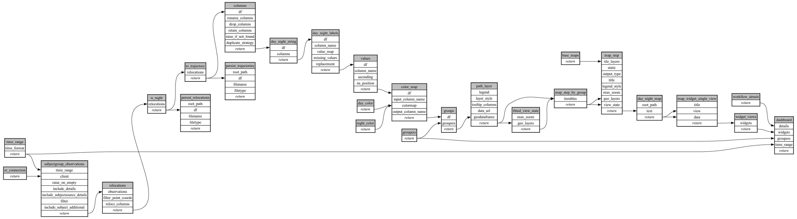

```
# AUTOGENERATED BY ECOSCOPE-WORKFLOWS; see fingerprint in README.md for details

```

```yaml
# fingerprint:
artifacts_sha256_basic: 02a9402e9e02f5c6434270ae30cd8dedffa165ce09934181ea4ac0c99ad0c14f
artifacts_sha256_strict: ac3d4c04b156a7cf55c5c00000c39d04d90cce8c39f259a015cb7e102037a2aa
installed_requirements:
- channel: https://repo.prefix.dev/ecoscope-workflows/
  name: ecoscope-platform
  version: {version: ==2.25.3}
- channel: https://repo.prefix.dev/ecoscope-workflows-custom/
  name: ecoscope-workflows-ext-custom
  version: {version: ==0.1.4}
- channel: conda-forge
  name: pydeck
  version: {version: ==0.9.2}
params_sha256: b46c295b9564ba5ffa9ca25f0db56c765b4d1ef81d14ad950b9e603aafb1e8c9
spec_sha256: d65b3e7cdc744a5b8d63488d72d8d6cfaa4dba86e4be9c8415d1b629a4fd91c4

```

# ecoscope-workflows-subject-day-night-location-map-workflow


